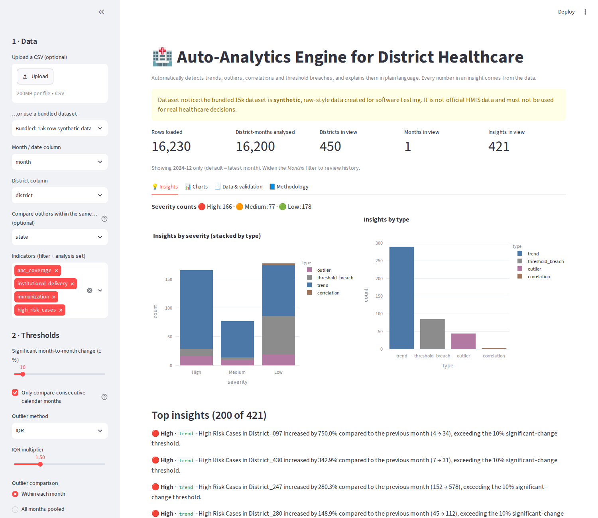
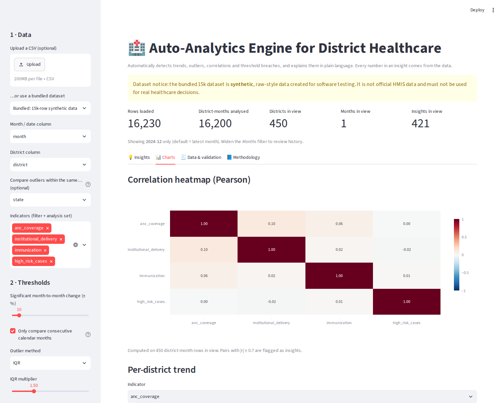
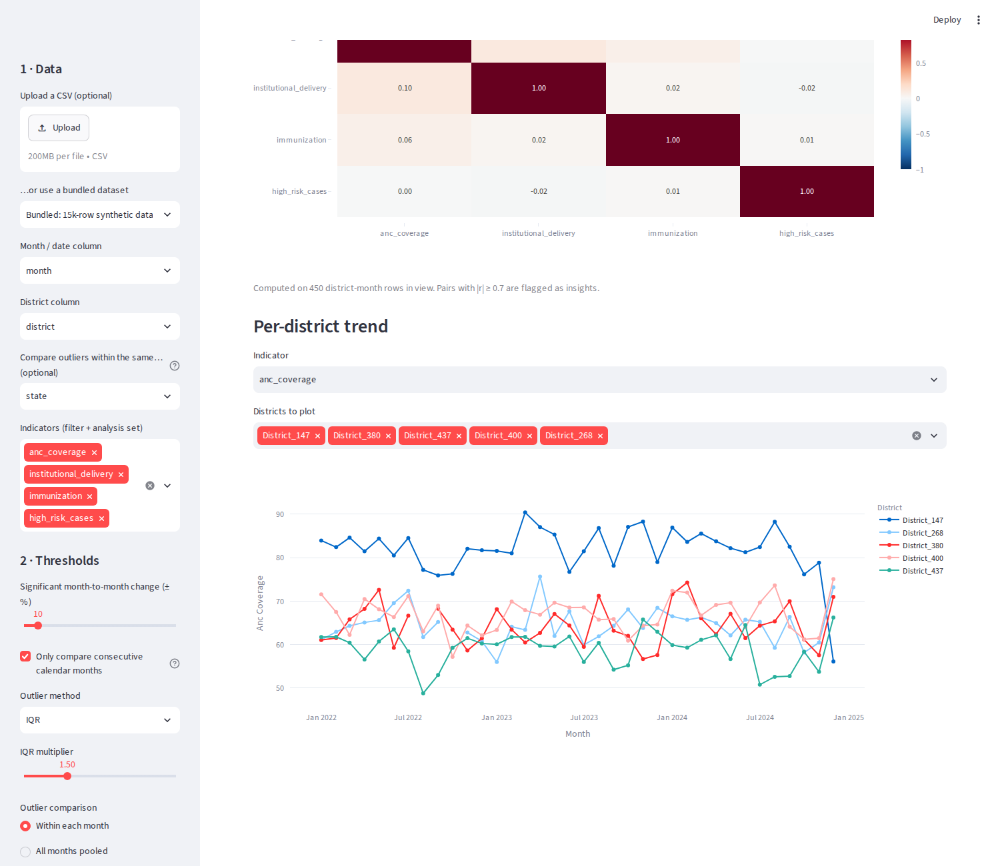
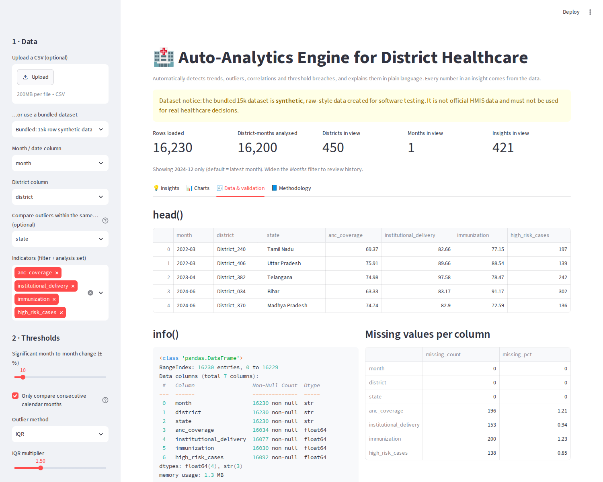

<div align="center">

# 🏥 Auto-Analytics Engine for District Healthcare

**Drop in a district-level healthcare CSV - get trends, outliers, correlations and threshold breaches, each explained in plain language.**


</div>

---

## ✨ Highlights

- 📈 **Trends** - month-over-month % change, flagged when it crosses a configurable threshold
- 🎯 **Outliers** - IQR or Z-score, judged per indicator per month (optionally within the same state)
- 🔗 **Correlations** - Pearson matrix across indicators, plus per-district correlation over time
- 🚨 **Threshold breaches** - values past data-derived (editable) limits
- 🗣️ **Plain-language explanations** - sentences are templates; every number, name and period comes from the data
- 🎚️ **Everything is a slider** - thresholds, methods and severity cut-offs; changing them changes the results
- 🧹 **Transparent cleaning** - merges district spelling variants, drops exact duplicates, never imputes, and logs it all
- 🧪 **Tested** - 21 unit tests covering formulas, thresholds, severity, schema and factuality

> ⚠️ `data/raw_district_healthcare_dataset_15k.csv` is **synthetic** raw-style data created for testing.
> It is not official HMIS data and must not be used for real healthcare or policy decisions.

## 📸 Screenshots

| Insights list | Correlation heatmap + trend line |
|---|---|
|  |  |

| Per-district line chart | Data & validation tab |
|---|---|
|  |  |

## 🚀 Quick start

```bash
# 1. (optional but recommended) virtual environment
python -m venv .venv
.venv\Scripts\Activate.ps1          # Windows PowerShell
# source .venv/bin/activate         # macOS / Linux

# 2. install
pip install -r requirements.txt

# 3. run
streamlit run app.py                # interactive UI at http://localhost:8501
pytest -q                           # 21 unit tests
python -m src.cli --csv data/raw_district_healthcare_dataset_15k.csv --out outputs/demo --top 50   # headless
```

Python 3.10+ (developed and tested on 3.12, pandas 3.0, Streamlit 1.65).

### Use your own data

Upload any CSV in the sidebar. It needs:

| Column | Required | Example |
|---|---|---|
| Month / date | ✅ | `2026-08` |
| District | recommended | `District_240` |
| State (for peer-group outliers) | optional | `Tamil Nadu` |
| One or more numeric indicators | ✅ | `anc_coverage`, `immunization` |

Columns are auto-detected and can be overridden in the sidebar. No district or indicator name is hard-coded.

### CLI options

| Flag | Default | Meaning |
|---|---|---|
| `--csv` | required | Input file |
| `--out` | `outputs` | Output folder |
| `--change-threshold` | `10` | Significant month-to-month change (± %) |
| `--outlier-method` | `IQR` | `IQR` or `Z-score` |
| `--outlier-threshold` | 1.5 (IQR) / 3 (Z) | IQR multiplier or \|z\| |
| `--outlier-scope` | `period` | `period` (per month) or `pooled` |
| `--min-peer-group` | `5` | Min districts needed for an outlier comparison |
| `--correlation-threshold` | `0.70` | \|r\| at or above this is flagged |
| `--top` | `0` (all) | Keep only the top-N insights |

## 🧭 How it works

```
CSV ─► validate & clean ─► panel (district × month) ─► trends ┐
                                                      outliers ├─► severity ─► insights table
                                                      correlations │            (CSV / JSON / UI)
                                                      breaches ┘
```

| Insight type | Method |
|---|---|
| **trend** | `pct_change = (current − previous) / previous × 100`; significant when `\|pct_change\| ≥ threshold` (default 10 %). Only the immediately preceding calendar month is used by default. |
| **outlier** | IQR fences (k default 1.5) or Z-score (default 3), computed per indicator per month, optionally within the same state. |
| **correlation** | Pearson via `DataFrame.corr()`; pairs with `\|r\| ≥ 0.70` flagged; per-district over time when enough months exist. |
| **threshold_breach** | Value beyond a limit (default: 5th-percentile tail of the data, editable). |

### Severity comes from your thresholds

Severity is how many **multiples of the threshold being tested** an observation reaches:

| Insight | Ratio |
|---|---|
| trend | `\|pct_change\| / change_threshold` |
| outlier (IQR) | distance beyond nearest quartile ÷ IQR ÷ k (1.0 = exactly on the fence) |
| outlier (Z) | `\|z\| / z_threshold` |
| threshold breach | gap to limit (%) ÷ change_threshold |

`Low < 1.25×` · `Medium 1.25–1.5×` · `High ≥ 1.5×` (both cut-offs are sliders). Correlation severity splits the range between the `|r|` threshold and 1.0 into thirds. There are no constants like `if change > 50`.

### Output schema

Every insight has the same fields:

`insight_id, type, indicator, entity, period, metric, value, prev_value, change_pct, change, severity, score, explanation`

- For outliers, `prev_value` is the peer mean and `change_pct` the deviation from it.
- For breaches, `prev_value` is the limit.
- For correlations, `value` is `r`.

Example explanations (from `outputs/synthetic_15k/insights.csv`):

> *High Risk Cases in District_430 increased by 2200.0% compared to the previous month (1 -> 23), exceeding the 10% significant-change threshold.* - **High**

> *High Risk Cases in District_352 was 1,723, 291.6% above the maximum limit of 440.* - **High**

## 🗂️ Project layout

| Path | Purpose |
|---|---|
| `app.py` | Streamlit UI: filters, sliders, insight list, severity chart, heatmap, line chart, validation tab |
| `src/insight_engine.py` | All analytics logic (pure functions, unit-tested, no UI code) |
| `src/cli.py` | Headless runner: prints head()/info()/missing report, writes CSV + JSON |
| `tests/test_engine.py` | 21 tests: formulas, thresholds, severity, schema, factuality, no hard-coded names |
| `data/` | 15k-row synthetic dataset |
| `outputs/` | Example `insights.csv`, `insights.json`, `correlation_matrix.csv` |
| `screenshots/` | UI screenshots |

## 🧹 Data handling (15k dataset)

The engine cleans a **copy** and logs what it did (it never modifies your upload):

- 25 district spellings merged (whitespace/case; 475 → 450 districts)
- 30 exact duplicate rows removed
- ~1 % missing values per indicator left as missing (not imputed)
- `high_risk_cases` correctly not treated as a percentage

## ⚠️ Limitations (please read)

- **Correlations are fragile on small data.** With few months × few districts, `|r|` near 1 is easy to get by chance. The UI warns when there are < 3 months or < 10 districts, and every correlation insight states its sample size.
- **Z-score cannot fire on tiny groups.** A population z-score is bounded by `(n−1)/√n` ≈ 2.04 for n = 6, so `|z| ≥ 3` is impossible; use IQR (default) for small peer groups. Raise *Minimum districts in a comparison group* to suppress over-sensitive IQR flags.
- **Percent change on small counts explodes** (e.g. 1 → 23 = +2,200 %). Check the raw values in the explanation.
- Testing many district × indicator pairs yields some chance findings; flags are prompts for review, not diagnoses.
- Correlation is not causation.
- Default breach limits are data-derived, **not clinical targets**.
- The UI defaults to the latest month; widen the *Months* filter to review history (~14.5k insights over 36 months on the 15k dataset).

## 🛠️ Tech stack

Python · pandas · NumPy · SciPy · Streamlit · Plotly · pytest

